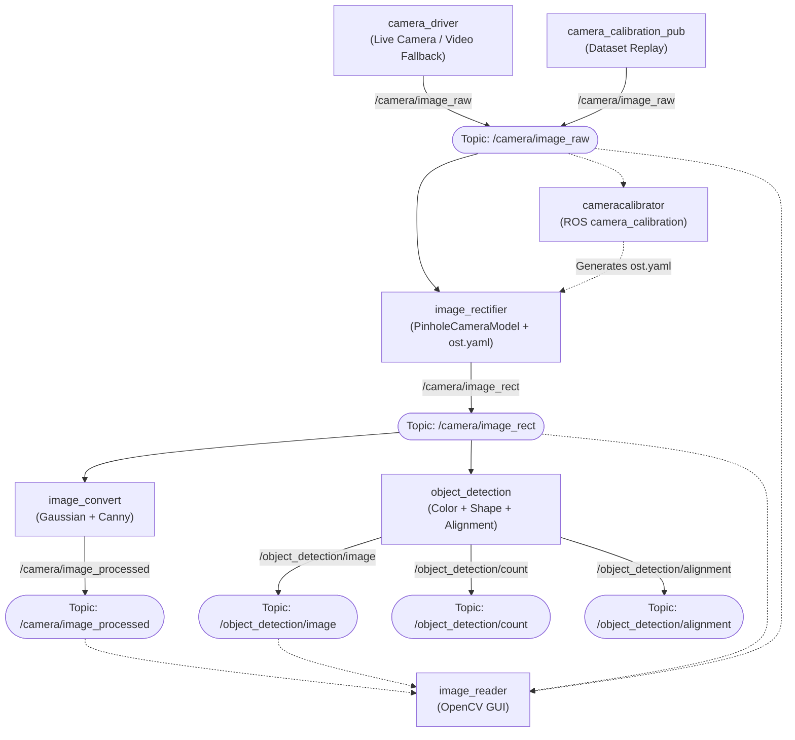

# 2D Image Processing with ROS 2 and OpenCV (`trsa_lab1`)

[](https://docs.ros.org/en/jazzy/)
[](https://releases.ubuntu.com/24.04/)
[](https://www.python.org/)
[](https://opencv.org/)

This repository contains the `trsa_lab1` ROS 2 package (`ament_python`, `rclpy`), developed for the TRSA course (Laboratory 1). It implements an end-to-end computer vision pipeline divided into two main parts:

1. **Part 1 — Acquisition, Calibration & Rectification:**
   - Real-time camera streaming with fallback video replay (`camera_driver`).
   - Image stream visualization via OpenCV GUI (`image_reader`).
   - Intrinsic camera calibration with checkerboard pattern and image rectification (`image_rectifier`).
2. **Part 2 — Filtering & Classical Object Detection:**
   - Grayscale conversion, Gaussian smoothing, and Canny edge detection (`image_convert`).
   - Real-time color segmentation (HSV) and shape classification (contours, polygonal approximation, solidity, circularity) (`object_detection`).
   - Target filtering / distractor rejection and visual alignment assistant (bonus).

---

## Architecture Overview



> [!NOTE]
> `camera_driver` and `camera_calibration_pub` must not run at the same time because both publish to `/camera/image_raw`.

---

## ROS 2 Topics

| Topic | Message Type | Published by | Subscribed by | Description |
| :--- | :--- | :--- | :--- | :--- |
| `/camera/image_raw` | `sensor_msgs/msg/Image` (bgr8) | `camera_driver`, `camera_calibration_pub` | `image_rectifier`, `image_reader`, `cameracalibrator` | Uncalibrated raw camera/video frames. |
| `/camera/image_rect` | `sensor_msgs/msg/Image` (bgr8) | `image_rectifier` | `image_convert`, `object_detection`, `image_reader` | Undistorted/rectified image stream. |
| `/camera/image_processed` | `sensor_msgs/msg/Image` (mono8) | `image_convert` | `image_reader`, RViz | Canny edge detection output. |
| `/object_detection/image` | `sensor_msgs/msg/Image` (bgr8) | `object_detection` | `image_reader`, RViz | Annotated image with bounding boxes, labels, and alignment cues. |
| `/object_detection/count` | `std_msgs/msg/Int32` | `object_detection` | External subscribers | Count of valid target objects in current frame. |
| `/object_detection/alignment` | `std_msgs/msg/String` | `object_detection` | External subscribers | Alignment state (`ALIGNED`, `LEFT`, `RIGHT`, `ABOVE`, `BELOW`, `NO_TARGET`). |

---

## Package Structure

```text
trsa_lab1/
├── calibration/
│   ├── images/                # 127 checkerboard images for offline calibration
│   └── ost.yaml               # Intrinsic camera parameters and distortion matrix
├── resource/
│   └── trsa_lab1              # ament package resource identifier
├── test/                      # Code style and packaging unit tests (pep257, flake8, copyright)
├── trsa_lab1/
│   ├── __init__.py
│   ├── camera_driver.py       # Camera capture / video loop publisher
│   ├── camera_calibration_pub.py # Calibration dataset publisher
│   ├── image_convert.py       # Grayscale, Gaussian blur, Canny filter
│   ├── image_reader.py        # OpenCV window visualizer
│   ├── image_rectifier.py     # Lens distortion correction using image_geometry
│   └── object_detection.py    # HSV segmentation, shape classification, alignment logic
├── video/
│   ├── test.mov               # Sample test video 1
│   ├── test2.mp4              # Sample test video 2
│   └── test3.mp4              # Fallback test video (used by camera_driver if no webcam)
├── package.xml                # ROS 2 package dependencies
├── setup.cfg
└── setup.py                   # Entry points and share directory asset installation
```

---

## Detailed Node Descriptions

### 1. `camera_driver`
- **Purpose**: Acquires frames from a local V4L2 camera device (`cv2.VideoCapture(0, cv2.CAP_V4L2)`) at 1280×720, 5 fps (MJPG), using a 1-frame buffer to prevent lag.
- **Fallback**: If no physical camera is accessible (e.g. in VMs or headless Docker without USB passthrough), it automatically falls back to streaming `video/test3.mp4` in a continuous loop.
- **Publishing**: Uses a ROS 2 timer at 30 Hz. Converts frames via `cv_bridge` to `sensor_msgs/msg/Image` with timestamp and frame ID `camera`.

### 2. `image_reader`
- **Purpose**: Lightweight visualizer subscribing to ROS 2 image topics and displaying them via OpenCV GUI windows.
- **Parameters**:
  - `topic` (default: `/camera/image_raw`): Primary image topic to display.
  - `processed_topic` (default: `/camera/image_processed`): Secondary image topic to display side-by-side.
- **Encoding**: Uses `passthrough` conversion to seamlessly support both color (`bgr8`) and edge maps (`mono8`).

### 3. `camera_calibration_pub`
- **Purpose**: Simulates a live camera during calibration by reading sequential calibration images (`calibration/images/0.jpeg` to `126.jpeg`) and publishing them at 15 Hz to `/camera/image_raw`. Once the last image is reached, it announces *"Calibrate Now!"* and holds the final frame.

### 4. `image_rectifier`
- **Purpose**: Subscribes to `/camera/image_raw`, removes lens distortion (radial and tangential), and publishes undistorted frames to `/camera/image_rect`.
- **Implementation**:
  - Parses camera parameters from `calibration/ost.yaml` into a `sensor_msgs/msg/CameraInfo`.
  - Initializes `image_geometry.PinholeCameraModel` once during node startup.
  - Rectifies frames via `camera_model.rectifyImage(input, output)` and preserves message headers and timestamps.

### 5. `image_convert`
- **Purpose**: Subscribes to `/camera/image_rect` and outputs an edge-filtered single-channel image to `/camera/image_processed`.
- **Pipeline**:
  1. Grayscale conversion: `cv2.cvtColor(img, cv2.COLOR_BGR2GRAY)`.
  2. Gaussian Blur: $21 \times 21$ kernel ($\sigma = 0$) to suppress high-frequency noise.
  3. Canny Edge Detector: hysteresis thresholds `80` and `100`.
  4. Encodes and publishes as `mono8`.

### 6. `object_detection`
- **Purpose**: Real-time multi-target detection combining color segmentation, contour analysis, geometric shape classification, target filtering, and spatial alignment assistance.
- **Input Topic**: Default `/camera/image_rect` (can be changed to `/camera/image_raw` via the `image_topic` parameter).
- **Color Segmentation (HSV)**:
  - Hue ranges (0–179 in OpenCV): Red (split ranges 0–10 and 170–179), Orange (11–24), Yellow (25–35), Yellow-Green (36–45), Green (46–80), Blue (81–130), Violet (131–169).
  - Minimum saturation (`sat_min = 100`) and value (`val_min = 100`) to eliminate white background and dark shadows.
  - Morphological closing with a $15 \times 15$ elliptical kernel fills small holes caused by highlights or reflections.
- **Shape Classification (`classify_shape`)**:
  - `approxPolyDP` (epsilon = 4% of contour perimeter):
    - 3 vertices $\rightarrow$ `Triangulo` (Triangle).
    - 4 vertices $\rightarrow$ `Retangulo` (Rectangle).
  - Solidity ($\text{Area} / \text{Convex Hull Area}$):
    - Solidity $< 0.8$ with $\ge 6$ vertices $\rightarrow$ `Estrela` (Star).
  - Circularity ($\text{Area} / \text{Minimum Enclosing Circle Area}$):
    - Circularity $> 0.75$ $\rightarrow$ `Circulo` (Circle).
- **Distractor Rejection**:
  - Only targets matching the `valid_targets` string list (format: `"<Shape> <Color>"`, e.g., `'Circulo Azul'`) are annotated and counted.
  - Distractors (e.g. matching color but wrong shape, or matching shape but wrong color) are ignored. Setting `valid_targets` to `['ALL']` disables the filter.
- **Visual Alignment Assistant (Bonus)**:
  - Tracks the largest valid detected target in the frame.
  - Measures pixel offsets $dx = c_x - t_x$ and $dy = c_y - t_y$ relative to target screen coordinates (`target_x`, `target_y`, default screen center `0.5, 0.5`).
  - Evaluates normalized deviations against tolerance thresholds (`tol_x = 0.05`, `tol_y = 0.05`).
  - Publishes state to `/object_detection/alignment`: `ALIGNED`, `LEFT`, `RIGHT`, `ABOVE`, `BELOW`, or `NO_TARGET`.

---

## Installation & Build Instructions

### Prerequisites
- OS: Ubuntu 24.04 LTS
- ROS 2: Jazzy Jalisco
- Standard ROS packages:
  ```bash
  sudo apt update
  sudo apt install -y \
    ros-jazzy-rclpy \
    ros-jazzy-sensor-msgs \
    ros-jazzy-std-msgs \
    ros-jazzy-cv-bridge \
    ros-jazzy-image-geometry \
    ros-jazzy-camera-calibration
  ```

### Build Workspace
Create or enter your ROS 2 workspace, place the package in `src/`, and build:

```bash
cd ~/ros2_ws
colcon build --symlink-install --packages-select trsa_lab1
source install/setup.bash
```

> [!TIP]
> Remember to source `install/setup.bash` in **every new terminal** before running nodes.

---

## How to Run

### 1. Basic Camera Stream & Visualizer
In Terminal 1 (Driver):
```bash
ros2 run trsa_lab1 camera_driver
```

In Terminal 2 (Viewer):
```bash
ros2 run trsa_lab1 image_reader
```

### 2. Camera Calibration (Offline)
Make sure `camera_driver` is **not running**.

In Terminal 1 (Calibrator tool):
```bash
ros2 run camera_calibration cameracalibrator \
  --size 8x6 \
  --square 0.0745 \
  --ros-args -r image:=/camera/image_raw -r camera:=/camera
```

In Terminal 2 (Replay calibration images):
```bash
ros2 run trsa_lab1 camera_calibration_pub
```

When the **CALIBRATE** button lights up green, click it, wait for computation, keep scale at 0, and click **SAVE**. Move the generated calibration files into `calibration/ost.yaml`, rebuild, and re-source.

### 3. Image Rectification
```bash
# Terminal 1: Camera
ros2 run trsa_lab1 camera_driver

# Terminal 2: Rectifier
ros2 run trsa_lab1 image_rectifier

# Terminal 3: View Rectified Stream
ros2 run trsa_lab1 image_reader --ros-args -p topic:=/camera/image_rect
```

### 4. Edge Detection (Canny)
```bash
# Terminal 1: Camera
ros2 run trsa_lab1 camera_driver

# Terminal 2: Rectifier
ros2 run trsa_lab1 image_rectifier

# Terminal 3: Edge Filter
ros2 run trsa_lab1 image_convert

# Terminal 4: View Both Raw Rectified and Processed
ros2 run trsa_lab1 image_reader --ros-args -p topic:=/camera/image_rect
```
*(This automatically opens two windows: `/camera/image_rect` and `/camera/image_processed`)*.

### 5. Object Detection & Alignment
```bash
# Terminal 1: Camera
ros2 run trsa_lab1 camera_driver

# Terminal 2: Rectifier
ros2 run trsa_lab1 image_rectifier

# Terminal 3: Detection Node
ros2 run trsa_lab1 object_detection

# Terminal 4: Display annotated feed
ros2 run trsa_lab1 image_reader --ros-args -p topic:=/object_detection/image
```

If running without a calibrated camera or using uncalibrated test videos directly:
```bash
ros2 run trsa_lab1 object_detection --ros-args -p image_topic:=/camera/image_raw
```

---

## Dynamic Configuration & Parameter Tuning

All detection parameters (except `image_topic`) can be adjusted live while the node is running:

### Target Filtering (`valid_targets`)
Specify target combinations using `"<Shape> <Color>"`:
- **Available Shapes**: `Circulo`, `Retangulo`, `Triangulo`, `Estrela`
- **Available Colors**: `Vermelho`, `Laranja`, `Amarelo`, `Amarelo-Verde`, `Verde`, `Azul`, `Violeta`

```bash
# Change active targets at startup:
ros2 run trsa_lab1 object_detection --ros-args -p valid_targets:="['Circulo Azul','Triangulo Amarelo']"

# Change active targets in real-time:
ros2 param set /object_detection valid_targets "['Retangulo Vermelho']"

# Accept all detected shapes and colors (disable distractor rejection):
ros2 param set /object_detection valid_targets "['ALL']"
```

### Alignment Target & Tolerances
Target location and tolerances are fractions of image dimensions (0.0 to 1.0):
```bash
# Move target center to (X: 40%, Y: 60%) with a 10% tolerance window
ros2 param set /object_detection target_x 0.4
ros2 param set /object_detection target_y 0.6
ros2 param set /object_detection tol_x 0.10
ros2 param set /object_detection tol_y 0.10
```

### Color Sensitivity
If objects fail to detect under dim physical room lighting:
```bash
ros2 param set /object_detection sat_min 70
ros2 param set /object_detection val_min 60
```

---

## Verification & Monitoring

Check active topics and diagnostics in separate terminals:
```bash
# Check published rates
ros2 topic hz /camera/image_raw
ros2 topic hz /object_detection/image

# Monitor detection output
ros2 topic echo /object_detection/count
ros2 topic echo /object_detection/alignment

# Visualize computation graph
rqt_graph
```

---

## Limitations

- **Overlapping Objects**: Overlapping objects sharing similar colors may merge into a single contour.
- **High-order Convex Polygons**: Regular pentagons or hexagons have high circularity ($>0.75$) and may be detected as circles.
- **Concave Shapes**: Star detection relies on solidity ($<0.8$); other irregular concave shapes with $\ge 6$ vertices could potentially be classified as stars.
- **Lighting Sensitivity**: Fixed HSV boundaries may require tweaking `sat_min` and `val_min` depending on ambient illumination.
- **Calibration Specificity**: The bundled `ost.yaml` corresponds strictly to the camera dataset provided in `calibration/images/`. Different physical cameras require their own calibration file.
